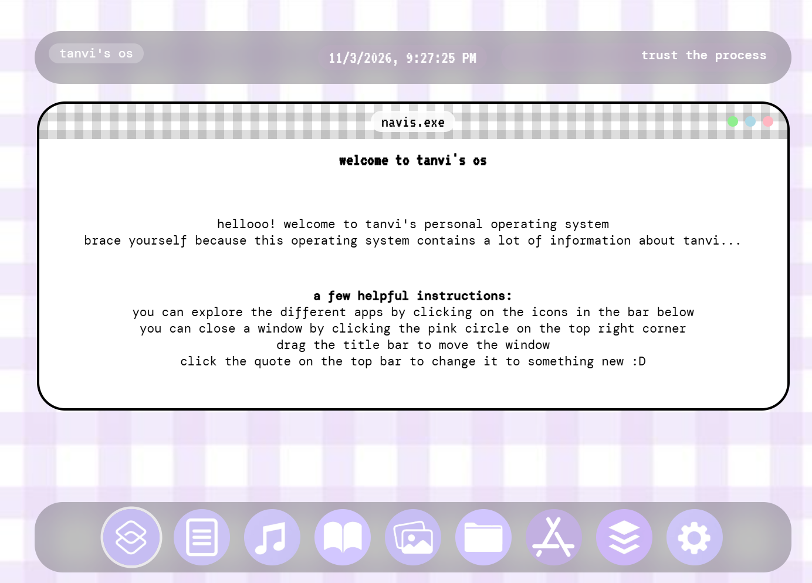

# tanvi's os

A personal website designed to look like a tiny operating system. Instead of scrolling a page, users open "apps" from a bar at the bottom of the screen. Each app opens in a draggable window.

Inspired by Hack Club's [Create Your Personal Web-based Operating System](https://jams.hackclub.com/batch/webOS) jam.

### Live Demo

[View Live Project](https://tanvimukka.github.io/personalOS/)

### Features

- Window sytem: click on an icon in the bottom bar to open its window, and click it again to close it. Only one window is open at a time.
- Draggable windows: drag any window by its checkered title bar. The pink circle closes a window.
- Live top bar: a running clock, and a quote that changes to a random one when you click it.
- Graduation countdown in the about window, calculated from today's date.
- Nine windows: welcome, about, music, books, photos, coding, apps, credits, and settings.
- Photo booth gallery: three overlapping, tilted photo strips that straighten on hover.
- Settings window: allows you to switch between four wallpapers and three fonts, show or hide the clock and quote, change the bottom bar icon size, or reset everything to the original setting.

### Built with

- HTML5
- CSS3
- JavaScript (ES6), with no libraries or frameworks
- Google Fonts: VT323, DM Mono, Open Sans, and Montserrat

### Running it locally

1. Download or clone this repository.
2. Open `index.html` in a browser.

There is nothing to install or build. The fonts load from Google Fonts, so you need an internet connection to see them.

### How it works

- Every window is a `div` with the class `window`, and every bottom bar icon is an image with the class `desktop-app-image`. An icon's `data-window` attribute holds the `id` of the window it opens, so `script.js` handles all of them with the same code.
- Dragging works by moving the window with a CSS `transform` while the mouse moves.
- Each setting stores its value in a `data-` attribute (for example, `data-wallpaper` or `data-font`), and `script.js` reads it when the control is used.

### Adding a new window

1. Copy an existing `
` block in `index.html`, then give it a new `id` and `style="display: none"`.
2. Add an `` icon inside the `bottom-bar` div.
3. Add any styles for it in `styles.css`.

No changes to `script.js` are needed.

### Known limitations + ideas for later

- Settings reset when the page is refreshed. Saving them with `localStorage` would fix that.
- Windows can only dragged with a mouse, not by touch.
- The layout is built mainly for desktop screens, and only the bottom bar icon size is adjusted for small screens.
- The quote changes only on click. It could also change on a timer.

### Inspiration

The idea and the starting layout for this project come from the first few parts of Hack Club's [Create Your Personal Web-based Operating System](https://jams.hackclub.com/batch/webOS) jam, created by SerenityUX. Over time I changed and added a lot of modifications which aren't mentioned in the jam.

### How I used AI

I built this project myself and used AI (Claude) as a helper when I got stuck. When I didn't know how to build a feature, I explained what I wanted and asked for hints or fill-in-the-blank outlines, then wrote and tested the code myself. I didn't use it for every feature, and I also looked things up on Google.

Features I got help with:
- After partially following the jam, my code got messy. I took help to organize the windows in .html and clean up their .css and .js, so if I ever need to make a new window, it's a very simple template.
- I didn't know how to create the checkered pattern for my top bar, so I took help there.
- To set up the graduation counter because I didn't know how to use the dates and numbers to create the countdown.
- The photo strip in the photos window. I mostly made the base strip, but took help in making them tilt, hover, and rotate.
- To link the buttons in the settings with .js functions which would actually temporarily change the style of the os.

The code comments and the first draft of this README were written with AI, and I reviewed and edited them heavily.

### Credits

- Design and code: Tanvi Mukka
- Photos: taken by Tanvi Mukka
- Book covers: belong to their respective owners and are shown for illustration only.
- App logos and wallpapers: found on Pinterest. Original creators unknown.
- Fonts: [Google Fonts](https://fonts.google.com/)
